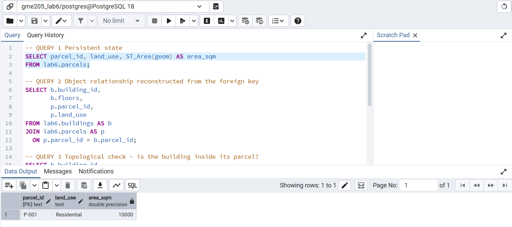
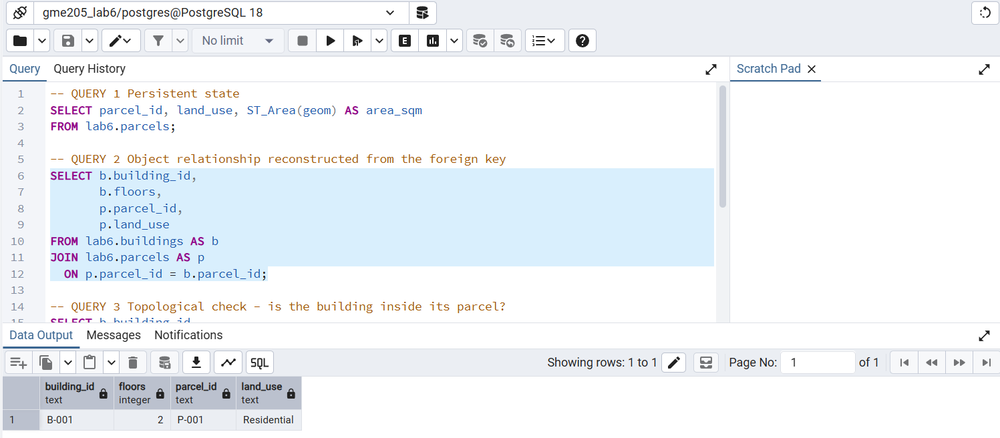
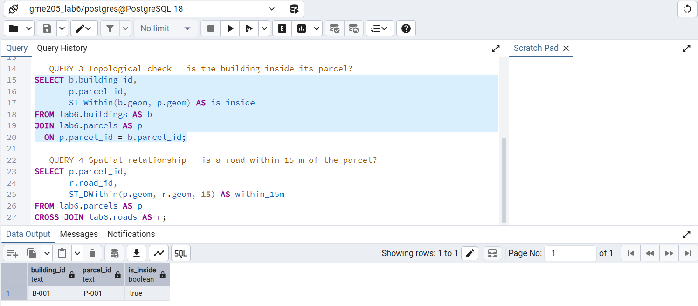
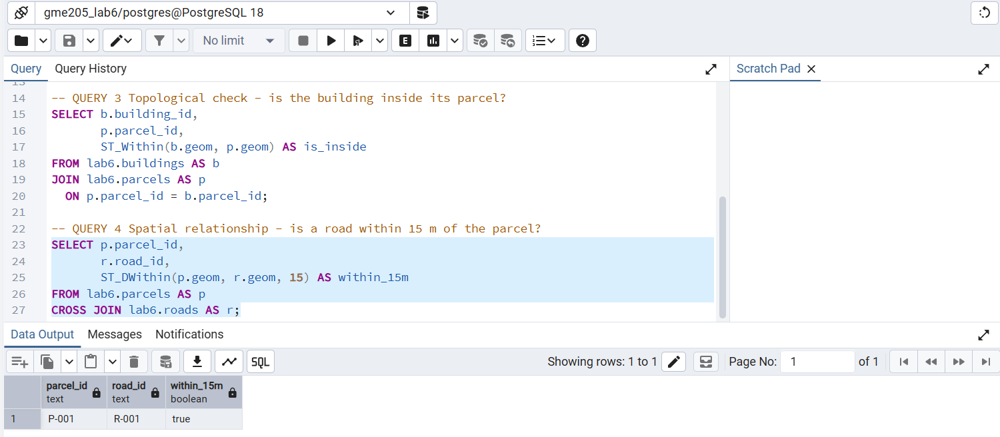

# GmE 205: Laboratory Exercise 6 
**Query Results and Interpretations**

Database: `gme205_lab6` (PostgreSQL 18.6, PostGIS 3.6.2)
Scripts run in order: `01_schema.sql` → `02_seed.sql` → `03_queries.sql`

---

## Query 1 – Persistent State (`ST_Area`)

| parcel_id | land_use | area_sqm |
|---|---|---|
| P-001 | Residential | 10000 |

**Interpretation:** P-001 was successfully stored as a database row containing land use and polygon geometry. The area (10,000 m² for a 100 m × 100 m parcel) was calculated from the stored geometry with `ST_Area` rather than a separate method result, so `area()` remains behavior rather than a column.

---

## Query 2 – Building → Parcel Relationship (JOIN)

| building_id | floors | parcel_id | land_use |
|---|---|---|---|
| B-001 | 2 | P-001 | Residential |

**Interpretation:** The JOIN restores the Building → Parcel relationship by matching the foreign key `buildings.parcel_id` to the primary key `parcels.parcel_id`. This confirms that B-001 belongs to P-001 using only persistent keys.

---

## Query 3 – Topological Check (`ST_Within`)

| building_id | parcel_id | is_inside |
|---|---|---|
| B-001 | P-001 | true |

**Interpretation:** The foreign key indicates that B-001 is associated with to P-001, while `ST_Within` verifies whether the geometry agrees. The result is `true`, so the building footprint (20–40 m) lies fully inside the parcel (0–100 m) and the stored key is spatially consistent.

---

## Query 4 – Spatial Relationship (`ST_DWithin`)

| parcel_id | road_id | within_15m |
|---|---|---|
| P-001 | R-001 | true |

**Interpretation:** Although the roads table does not contain a `parcel_id`, `ST_DWithin` identifies that road R-001 is within 15 m of parcel P-001, as the road runs 10 m south of the parcel boundary. This relationship is discovered from geometry when the question is asked rather than stored as a foreign key.